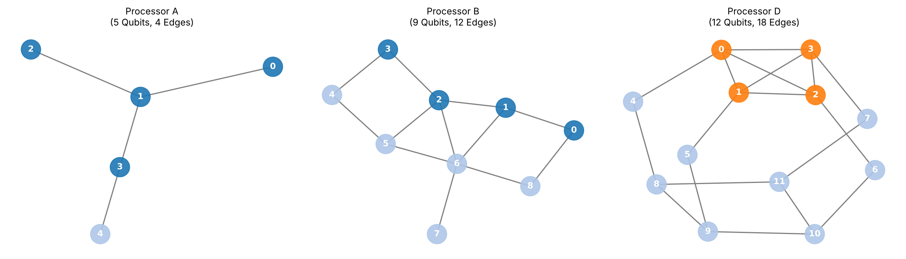
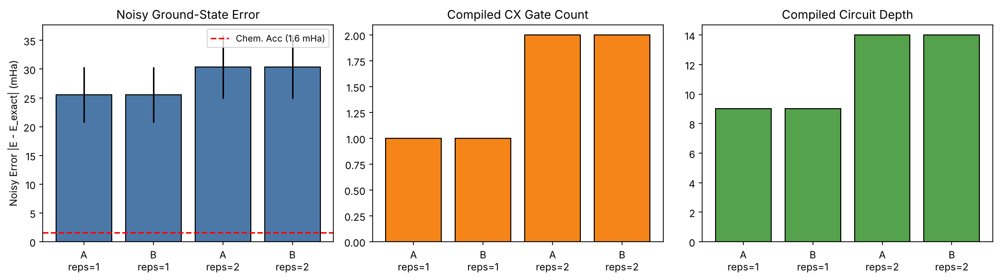

# Qiskit Fall Fest 2026 - PS-C1: H2 Ground-State Energy (VQE) on Constrained Processors

**Team:** Team X - Shivansh Kumar and Aparna Bhadoriya
**Track:** Quantum Chemistry - PS-C1 (Phase 1)

We estimate the ground-state energy of H2 (STO-3G, R = 0.735 A) with VQE, run it under the organizers' fixed noise model on Processor A (5-qubit tree) and Processor B (9-qubit graph), study how coupling topology changes routing cost, and propose a 12-qubit Processor D.
**Every number below is read from `results/tables/*.csv` by `src/build_docs.py`.**

## 1. Headline results

- **Exact reference:** E_FCI = -1.1373060358 Ha (2-qubit parity-mapped Hamiltonian + nuclear repulsion 0.7199689944 Ha). Chemical accuracy = 1.6 mHa.
- **Ideal VQE** (statevector, COBYLA) reaches the exact energy to ~1e-7 mHa for all three ansatze.
- **Required A vs B benchmark:** the 2-qubit circuit needs only one CX, so both processors compile it identically (0 SWAPs, same CX/depth) and give the same noisy energy. The raw noisy error is about 24.4 mHa, far above chemical accuracy.
- **Error mitigation (Processor A, compact 1-parameter ansatz):** readout inversion + parity postselection + linear ZNE (scales 1 and 3, chosen in advance) lowers the mean bias to **1.90 mHa at the organizer's 4096 shots**, but run-to-run std is **9.2 mHa**, so only **1/10** individual runs are within 1.6 mHa. With 32768 shots (our extra setting) the mean bias is 0.46 mHa, std 1.80 mHa, and 7/10 runs are within 1.6 mHa. **We therefore do not claim reliable chemical accuracy; we claim a large, measured bias reduction whose precision is shot-limited.**
- **Topology matters once the circuit is bigger.** On a 4-qubit all-pairs-style entangling circuit (a routing stress test, not a chemistry result) compiled CX / SWAPs / depth are A: 12/2/26, B: 9/1/18, D: 6/0/15.

## 2. Problem and method

- 4 spin-orbitals -> parity mapping with Z2 tapering -> 2 qubits: H = g0 II + g1 IZ + g2 ZI + g3 ZZ + g4 XX with g = (-1.05237325, +0.39793742, -0.39793742, -0.01128010, +0.18093120) Ha (`data/processed/h2_2qubit_hamiltonian.json`).
- Ansatze: hardware-efficient RY+CX (reps 1 and 2) and a 1-parameter, 1-CX singlet ansatz (X, RY, CX).
- Noise (organizer, fixed): 1q depolarizing 0.001 on sx/x; CX depolarizing 0.005; readout flip 0.01. 4096 shots. Transpile: basis {rz, sx, x, cx}, `optimization_level=1`, SABRE layout/routing, `seed_transpiler=42`.
- Mitigation: (1) readout confusion-matrix inversion (20000 calibration shots); (2) parity postselection (odd parity); (3) ZNE by whole-circuit unitary folding at scales 1, 3 (primary, linear: E0 = (3E1 - E3)/2) and 5 (quadratic Richardson reported only for comparison). **The primary estimator is fixed in code (linear 1,3); it is never selected by comparing against the exact energy.**
- Statistics: mean and std over 10 seeds (42-51). Extrapolation amplifies shot noise (about 1.6x for linear, 2.3x for quadratic), which is why ZNE has a larger std than its inputs.

## 3. Processors

| Processor | Qubits | Edges | Degree (min-max) | Diameter | Independent cycles |
|---|:-:|:-:|:-:|:-:|:-:|
| A (organizer) | 5 | 4 | 1-3 | 3 | 0 (tree) |
| B (organizer) | 9 | 12 | 1-5 | 4 | 4 |
| D (team design) | 12 | 18 | 2-4 | 3 | 7 |

Processor B uses the 12-edge map from the organizers' Benchmark Configuration PDF. The Giant Kit lists different maps; they are run as extra `*_giantkit_variant` rows in `AB_comparison_full.csv` and give identical results for this 2-qubit problem.



## 4. Required benchmark: Processor A vs B (Phase 1 table)

| Processor | Ansatz | Phys. qubits | Compiled CX | Depth | SWAPs | Noisy energy (Ha, mean of 10 seeds) | Error (mHa) | Std over seeds (mHa) |
|---|---|:-:|:-:|:-:|:-:|:-:|:-:|:-:|
| Processor A | HEA_reps=1 | 5 | 1 | 9 | 0 | -1.111738 | 25.57 | 4.84 |
| Processor B | HEA_reps=1 | 9 | 1 | 9 | 0 | -1.111738 | 25.57 | 4.84 |
| Processor A | HEA_reps=2 | 5 | 2 | 14 | 0 | -1.106925 | 30.38 | 5.54 |
| Processor B | HEA_reps=2 | 9 | 2 | 14 | 0 | -1.106925 | 30.38 | 5.54 |

Both processors place the 2 logical qubits on an adjacent pair, so compiled circuits, noise streams and energies coincide. The deeper ansatz (reps 2) adds a CX and more depth and is worse (more noise, no accuracy benefit since reps 1 is already exact in the ideal case). Full table: `results/tables/AB_comparison.csv`.



## 5. Error mitigation study (Processor A)

| Stage | Shots | Mean energy (Ha) | \|Bias\| (mHa) | Std over 10 seeds (mHa) | Runs within 1.6 mHa | Mean bias within 1.6 mHa? |
|---|:-:|:-:|:-:|:-:|:-:|:-:|
| 1. Raw Noisy | 4096 | -1.112934 | 24.37 | 4.91 | 0/10 | no |
| 2. Readout Mitigated | 4096 | -1.129896 | 7.41 | 5.04 | 1/10 | no |
| 3. Readout + Symmetry | 4096 | -1.132433 | 4.87 | 4.51 | 2/10 | no |
| 4. Readout+Sym+ZNE (linear 1,3) | 4096 | -1.135404 | 1.90 | 9.21 | 1/10 | no |
| 5. ZNE quadratic (1,3,5), comparison only | 4096 | -1.132997 | 4.31 | 11.84 | 0/10 | no |
| 1. Raw Noisy | 32768 | -1.114482 | 22.82 | 1.67 | 0/10 | no |
| 2. Readout Mitigated | 32768 | -1.131846 | 5.46 | 1.72 | 0/10 | no |
| 3. Readout + Symmetry | 32768 | -1.133197 | 4.11 | 1.71 | 1/10 | no |
| 4. Readout+Sym+ZNE (linear 1,3) | 32768 | -1.136846 | 0.46 | 1.80 | 7/10 | yes |
| 5. ZNE quadratic (1,3,5), comparison only | 32768 | -1.136664 | 0.64 | 2.69 | 5/10 | yes |


Reading it honestly: readout inversion and parity postselection give robust, large improvements. ZNE removes most of the remaining *bias* but multiplies the shot noise, so at 4096 shots a single run lands within 1.6 mHa only occasionally. More shots (or averaging several runs) is what makes the result usable.

## 6. Architecture analysis

**4-qubit routing stress test** (`full_entangling_4q_ansatz`: RY layer, 6 CX on pairs (0,1),(1,2),(2,3),(3,0),(0,2),(1,3), RY layer; it is *not* a UCCSD circuit):

| Processor | Phys. qubits | Logical CX | Compiled CX | SWAPs | Depth |
|---|:-:|:-:|:-:|:-:|:-:|
| Processor A | 5 | 6 | 12 | 2 | 26 |
| Processor B | 9 | 6 | 9 | 1 | 18 |
| Processor D | 12 | 6 | 6 | 0 | 15 |

A is a tree with no cycles, so the 4-cycle and chords cannot be embedded without SWAPs; B has cycles and needs fewer; D's K4 core hosts the pattern directly.

**Placement sensitivity of the 2-qubit circuit** (all ordered physical placements, forced initial layout):

| Processor | Ordered placements of 2 logical qubits | Mean CX | Max CX | Zero-SWAP placements | Max distance |
|---|:-:|:-:|:-:|:-:|:-:|
| Processor A | 20 | 3.40 | 7 | 40% | 3 |
| Processor B | 72 | 3.83 | 10 | 33% | 4 |
| Processor D | 132 | 4.18 | 7 | 27% | 3 |

| Processor | Placement | Phys. qubits | Distance | CX | SWAPs | Depth | Error (mHa) |
|---|---|:-:|:-:|:-:|:-:|:-:|:-:|
| Processor A | best | (0,1) | 1 | 1 | 0 | 9 | 23.8 |
| Processor A | worst | (4,2) | 3 | 7 | 2 | 12 | 37.4 |
| Processor B | best | (0,1) | 1 | 1 | 0 | 9 | 23.8 |
| Processor B | worst | (4,0) | 4 | 10 | 3 | 15 | 45.2 |
| Processor D | best | (0,1) | 1 | 1 | 0 | 9 | 23.8 |
| Processor D | worst | (11,5) | 3 | 7 | 2 | 12 | 38.4 |

Placement matters: the worst placement costs several extra CX and tens of mHa. Note the best-placement rows use a forced layout and different seed handling than the Phase 1 table, so their errors differ slightly from it.


## 7. Processor D (team design)

- **12 qubits, 18 edges.** K4 core on qubits {0,1,2,3}; spokes (0,4), (1,5), (2,6), (3,7); links (4,8), (5,9), (6,10), (7,11); ring 8-9-10-11-8. Degree 2-4, diameter 3.
- **Same noise as A/B** (no favourable errors), <= 12 qubits, explicit graph, CX + 1q gates.
- **Bottleneck addressed:** the tree/sparse topologies of A and B force SWAPs for circuits whose interaction graph contains cycles or K4-like patterns. D embeds a 4-qubit clique natively: 0 SWAPs, 6 CX vs 12 on A for the stress test.
- **Limits, stated plainly:** D is tailored to the K4 stress-test circuit. Only 4 qubits are used for it (the other 8 are unused here), and the 7 independent cycles/higher degree cost hardware (crosstalk, fabrication). For the 2-qubit problem D gives no benefit (same CX/depth/energy as A and B), and across *all* 2-qubit placements its mean CX is not lower than A's or B's (table above). A fair claim is "D removes SWAPs for 4-qubit all-pairs circuits", not "D is better in general".

## 8. Repository layout

```
README.md  report.md  main.ipynb  requirements.txt
data/raw, data/processed         H2 geometry and Hamiltonians (JSON)
processors/                      A, B, D (+ Giant-Kit variants) as JSON coupling maps
src/problem.py processors.py routing.py metrics.py visualization.py
src/build_docs.py            regenerates README/report numbers from the CSVs
results/tables, results/figures   all generated outputs
assets/qff_phase1_latex_images   LaTeX equation PNGs (Starter Guide rendering note)
```

## 9. Reproduce

```bash
python -m venv .venv && source .venv/bin/activate   # Windows: .venv\Scripts\activate
pip install -r requirements.txt                     # pinned: qiskit==2.5.2, qiskit-aer==0.17.2
python -c "from src import run_full_benchmark; run_full_benchmark()"   # ~30 s
python -m src.build_docs                        # refresh README/report numbers
jupyter nbconvert --execute --inplace main.ipynb
```

Results were generated with Python 3.13, Qiskit 2.5.2, Qiskit Aer 0.17.2. Other versions may change SABRE routing and sampled noise slightly.

## 10. Limitations

- Minimal STO-3G basis, one bond length (0.735 A), synthetic Aer noise (no T1/T2, crosstalk, drift).
- The 4-qubit circuit is a generic routing stress test, not a variationally optimized H2 4-qubit state.
- Readout calibration uses exact basis-state circuits (no state-prep error), and ZNE uses whole-circuit folding with only 2-3 scale factors.
- Processor D is a proposal evaluated only in simulation on one circuit family.

## 11. AI assistance disclosure

AI assistants (Claude, and earlier Gemini/Antigravity) were used to draft and refactor code, run reviews, and revise documentation. The team ran the pipeline, checked results against the CSVs and the organizer specification, and is responsible for the submission.

## License
Apache 2.0 - see [LICENSE](LICENSE).
