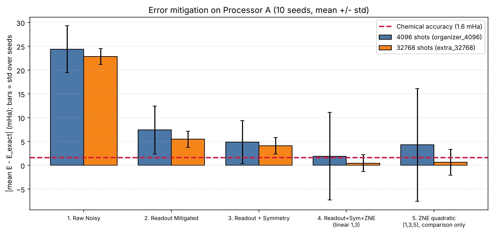
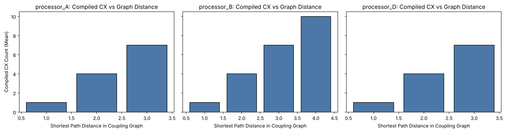

# PS-C1 Technical Report: H2 Ground-State Energy under Constrained Processor Topologies

**Team X** - Shivansh Kumar and Aparna Bhadoriya. Qiskit Fall Fest 2026, Phase 1.
All numbers are read from `results/tables/*.csv`.

## 1. Problem
Find the ground-state energy of H2 (STO-3G, R = 0.735 A) with VQE and quantify how noise and processor connectivity affect it. The exact total energy is E_FCI = -1.1373060358 Ha (electronic -1.8572750302 Ha + nuclear repulsion 0.7199689944 Ha). Chemical accuracy is 1.6 mHa.

## 2. Hamiltonian
Parity mapping with Z2 tapering reduces the 4 spin-orbital problem to 2 qubits: H = g0 II + g1 IZ + g2 ZI + g3 ZZ + g4 XX, g = (-1.05237325, +0.39793742, -0.39793742, -0.01128010, +0.18093120) Ha. Exact diagonalization of this 4x4 matrix reproduces E_FCI.

## 3. Ansatze and ideal VQE
HEA reps 1 (4 parameters, 1 CX), HEA reps 2 (6 parameters, 2 CX), and a singlet ansatz with 1 parameter (X, RY, CX). With COBYLA on the noiseless statevector, all three reach the exact energy to ~1e-7 mHa, so expressibility is not the bottleneck; noise is.

## 4. Required benchmark: Processor A vs Processor B
Setup: organizer noise model (1q depolarizing 0.001, CX depolarizing 0.005, readout flip 0.01), 4096 shots, basis {rz, sx, x, cx}, `optimization_level=1`, SABRE layout and routing, `seed_transpiler=42`, 10 seeds (42-51).

| Processor | Ansatz | Phys. qubits | Compiled CX | Depth | SWAPs | Noisy energy (Ha, mean of 10 seeds) | Error (mHa) | Std over seeds (mHa) |
|---|---|:-:|:-:|:-:|:-:|:-:|:-:|:-:|
| Processor A | HEA_reps=1 | 5 | 1 | 9 | 0 | -1.111738 | 25.57 | 4.84 |
| Processor B | HEA_reps=1 | 9 | 1 | 9 | 0 | -1.111738 | 25.57 | 4.84 |
| Processor A | HEA_reps=2 | 5 | 2 | 14 | 0 | -1.106925 | 30.38 | 5.54 |
| Processor B | HEA_reps=2 | 9 | 2 | 14 | 0 | -1.106925 | 30.38 | 5.54 |

Both processors offer an adjacent pair, so the 2-qubit circuit compiles identically (0 SWAPs). The A-vs-B difference is therefore invisible at this size; the raw noisy error (about 24.4 mHa) comes from gate and readout noise, not routing.

## 5. Error mitigation
Applied to the 1-parameter ansatz on Processor A. Readout inversion uses a 4x4 confusion matrix from 20000 calibration shots with simplex projection. Parity postselection keeps odd-parity outcomes. ZNE folds the whole circuit (U -> U (U^dag U)^((s-1)/2)) at scales 1, 3, 5. The **pre-specified** estimator is linear Richardson on scales 1 and 3, E0 = (3E1 - E3)/2; the quadratic (1, 3, 5) extrapolation, E0 = 15/8 E1 - 5/4 E3 + 3/8 E5, is reported only for comparison. Neither was selected using the exact energy.

| Stage | Shots | Mean energy (Ha) | \|Bias\| (mHa) | Std over 10 seeds (mHa) | Runs within 1.6 mHa | Mean bias within 1.6 mHa? |
|---|:-:|:-:|:-:|:-:|:-:|:-:|
| 1. Raw Noisy | 4096 | -1.112934 | 24.37 | 4.91 | 0/10 | no |
| 2. Readout Mitigated | 4096 | -1.129896 | 7.41 | 5.04 | 1/10 | no |
| 3. Readout + Symmetry | 4096 | -1.132433 | 4.87 | 4.51 | 2/10 | no |
| 4. Readout+Sym+ZNE (linear 1,3) | 4096 | -1.135404 | 1.90 | 9.21 | 1/10 | no |
| 5. ZNE quadratic (1,3,5), comparison only | 4096 | -1.132997 | 4.31 | 11.84 | 0/10 | no |
| 1. Raw Noisy | 32768 | -1.114482 | 22.82 | 1.67 | 0/10 | no |
| 2. Readout Mitigated | 32768 | -1.131846 | 5.46 | 1.72 | 0/10 | no |
| 3. Readout + Symmetry | 32768 | -1.133197 | 4.11 | 1.71 | 1/10 | no |
| 4. Readout+Sym+ZNE (linear 1,3) | 32768 | -1.136846 | 0.46 | 1.80 | 7/10 | yes |
| 5. ZNE quadratic (1,3,5), comparison only | 32768 | -1.136664 | 0.64 | 2.69 | 5/10 | yes |

Findings. (i) Readout inversion removes most of the bias (raw 24.4 mHa to 7.4 mHa at 4096 shots). (ii) Postselection helps slightly. (iii) Linear ZNE reduces the mean bias to 1.90 mHa at 4096 shots, but extrapolation amplifies shot noise: the std over seeds is 9.2 mHa and only 1/10 runs are within chemical accuracy. At 32768 shots the mean bias is 0.46 mHa with std 1.80 mHa and 7/10 runs within 1.6 mHa. **Chemical accuracy is therefore reached on average only in the higher-shot setting, and not reliably in any single run.** Quadratic extrapolation is noisier still.

## 6. Architecture analysis
Graph facts:

| Processor | Qubits | Edges | Degree (min-max) | Diameter | Independent cycles |
|---|:-:|:-:|:-:|:-:|:-:|
| A (organizer) | 5 | 4 | 1-3 | 3 | 0 (tree) |
| B (organizer) | 9 | 12 | 1-5 | 4 | 4 |
| D (team design) | 12 | 18 | 2-4 | 3 | 7 |

4-qubit routing stress test (generic ansatz with CX on (0,1),(1,2),(2,3),(3,0),(0,2),(1,3); not a chemistry-derived circuit):

| Processor | Phys. qubits | Logical CX | Compiled CX | SWAPs | Depth |
|---|:-:|:-:|:-:|:-:|:-:|
| Processor A | 5 | 6 | 12 | 2 | 26 |
| Processor B | 9 | 6 | 9 | 1 | 18 |
| Processor D | 12 | 6 | 6 | 0 | 15 |

A tree cannot embed a 4-cycle or its chords, so SWAPs are unavoidable; each SWAP costs 3 CX, each CX carries 0.5% depolarizing error. B's cycles reduce but do not remove the overhead.

Placement sensitivity for the 2-qubit circuit (ordered physical placements, forced layout):

| Processor | Ordered placements of 2 logical qubits | Mean CX | Max CX | Zero-SWAP placements | Max distance |
|---|:-:|:-:|:-:|:-:|:-:|
| Processor A | 20 | 3.40 | 7 | 40% | 3 |
| Processor B | 72 | 3.83 | 10 | 33% | 4 |
| Processor D | 132 | 4.18 | 7 | 27% | 3 |

| Processor | Placement | Phys. qubits | Distance | CX | SWAPs | Depth | Error (mHa) |
|---|---|:-:|:-:|:-:|:-:|:-:|:-:|
| Processor A | best | (0,1) | 1 | 1 | 0 | 9 | 23.8 |
| Processor A | worst | (4,2) | 3 | 7 | 2 | 12 | 37.4 |
| Processor B | best | (0,1) | 1 | 1 | 0 | 9 | 23.8 |
| Processor B | worst | (4,0) | 4 | 10 | 3 | 15 | 45.2 |
| Processor D | best | (0,1) | 1 | 1 | 0 | 9 | 23.8 |
| Processor D | worst | (11,5) | 3 | 7 | 2 | 12 | 38.4 |

Poor placement costs up to several extra CX and tens of mHa of added error. (The "best" rows use a forced layout, so they differ slightly from the Phase 1 table.)

## 7. Processor D
12 qubits, 18 edges: K4 core on {0,1,2,3}, spokes (0,4),(1,5),(2,6),(3,7), links (4,8),(5,9),(6,10),(7,11), ring 8-9-10-11-8; degree 2-4, diameter 3; same noise as A and B. It addresses the SWAP bottleneck that A and B hit on circuits with cycles/K4 patterns: the stress test compiles to 6 CX, 0 SWAPs, depth 15, versus 12 CX / 2 SWAPs / depth 26 on A and 9 / 1 / 18 on B.

Caveats: D is designed around that one circuit; 8 of its 12 qubits are unused in it; higher connectivity has real hardware costs not modeled here; and for the 2-qubit problem D gives no advantage and over all 2-qubit placements has no lower mean CX than A or B.

## 8. Limitations
STO-3G and a single bond length; synthetic noise only; generic (non-optimized) 4-qubit circuit; idealized readout calibration; ZNE with few scale factors; D validated in simulation on one circuit family.

## 9. Reproducibility
Qiskit 2.5.2, Qiskit Aer 0.17.2 (pinned in `requirements.txt`). `python -c "from src import run_full_benchmark; run_full_benchmark()"` then `python scripts/build_docs.py`.
